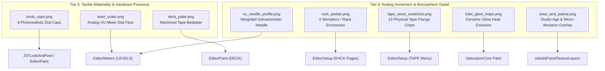
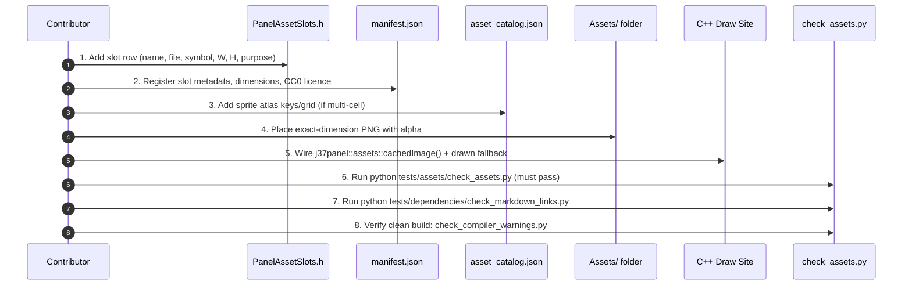

# Asset Plan: Architectural Strategy, Visual Craft, and Additive Art Pipeline

The panel is drawn primarily from code: every plate, bezel, knob body, scale tick, and chassis division is derived from procedural arithmetic and dynamic palette math. This foundation guarantees that MiBoX remains pin-sharp on any display scale (100% to 300%+ Retina/HiDPI), reacts instantaneously to arbitrary window resizing, and adapts dynamically across six distinct physical themes.

The assets stored under [`Assets/`](../Assets/) represent the **additive layer**: physical micro-textures, tactile materials, skeuomorphic surface details, product trademarks, and symbolic glyphs that enrich the procedural drawing without replacing its structural logic.

> [!IMPORTANT]
> **The Zero-Asset Invariant**: A clean checkout with an empty `Assets/` directory builds cleanly and runs as a fully featured, visually complete plugin. Every draw site queries its asset slot through [`Source/GUI/PanelAssets.h`](../Source/GUI/PanelAssets.h) and transparently falls back to procedural drawing when the bitmap is absent or invalid.

This document serves as the **master plan and architectural roadmap**. The slot catalog with exact pixel coordinates is documented in [`Assets/asset_catalog.json`](../Assets/asset_catalog.json), metadata and licensing provenance live in [`Assets/manifest.json`](../Assets/manifest.json), and the single source of truth across the C++ codebase is [`Source/GUI/PanelAssetSlots.h`](../Source/GUI/PanelAssetSlots.h).

---

## Current Status and Audit

All 15 declared primary slots are implemented and verified. Running:
```sh
python tests/assets/check_assets.py
```
reports `ASSET CHECK PASSED (15 declared slots, 15 files in Assets/)`.

### Asset Memory and Runtime Footprint

All assets are embedded directly into the binary target via `juce_add_binary_data` and decoded on demand onto the message thread via `j37panel::assets::cachedImage()`:

| Slot | File Name | Dimensions (px) | Grid / Tile Spec | Format & Transparency | Runtime RAM (Uncompressed) |
| --- | --- | --- | --- | --- | --- |
| `panel_texture` | `panel_texture.png` | 1024 × 512 | Single canvas | Grayscale + Alpha (seamless chassis) | 2.0 MB |
| `panel_materials` | `panel_materials.png` | 3072 × 256 | 6 tiles (512 × 256) | Multi-material atlas (`ThemeChoice`) | 3.0 MB |
| `brand_mark` | `brand_mark.png` | 256 × 256 | Single mark | Full Colour + Alpha | 0.25 MB |
| `window_icon` | `window_icon.png` | 64 × 64 | Single icon | High-contrast 2-tone Alpha | 16 KB |
| `principle_icons` | `principle_icons.png` | 576 × 64 | 9 glyphs (64 × 64) | Pure White Alpha Mask | 144 KB |
| `factory_preset_art`| `factory_preset_art.png`| 2240 × 64 | 35 tiles (64 × 64) | Palette Accent + Alpha | 560 KB |
| `ui_icons` | `ui_icons.png` | 512 × 832 | 104 cells (64 × 64) | White Stroke Alpha Mask | 1.66 MB |
| `parameter_glyphs` | `parameter_glyphs.png` | 512 × 832 | 97 glyphs (64 × 64) | White Stroke Alpha Mask | 1.66 MB |
| `machine_models` | `machine_models.png` | 512 × 512 | 57 glyphs (64 × 64) | White Silhouette Alpha Mask | 1.0 MB |
| `meter_status` | `meter_status.png` | 512 × 256 | 32 glyphs (64 × 64) | White Accent Alpha Mask | 0.5 MB |
| `preset_categories`| `preset_categories.png`| 512 × 64 | 8 glyphs (64 × 64) | White Stroke Alpha Mask | 128 KB |
| `hardware_details` | `hardware_details.png` | 256 × 256 | 16 cells (64 × 64) | Neutral Tone + Shadows | 0.25 MB |
| `brand_lockups` | `brand_lockups.png` | 512 × 128 | 4 cells (128 × 128)| Full Colour & Monochrome | 0.25 MB |
| `help_illustrations`|`help_illustrations.png`| 1024 × 576 | 4 scenes (512 × 288)| Illustrated Technical Line Art | 2.25 MB |
| `signal_path` | `signal_path.png` | 1600 × 500 | Standalone plate | Full Console Strip Graphic | 3.05 MB |
| **Total** | | | **320+ sprite cells** | | **~16.7 MB RAM** |

---

## Art Direction & Visual Craft Principles

MiBoX balances **modern flat legibility** with the **visceral warmth of vintage high-end analog machinery** (Neo-Skeuomorphism). Art assets must adhere to strict craft rules to blend naturally into the UI:

### 1. Alpha Mask vs. Full Colour Rules
- **Tintable Vector Glyphs (`ui_icons`, `parameter_glyphs`, `principle_icons`, `meter_status`)**:
  - Authored strictly as **white (`#FFFFFF`) with anti-aliased alpha transparency**.
  - JUCE dynamically tints these at render time using `g.setColour(palette.primary)` or `palette.accent`.
  - Never bake colours, grays, or drop shadows into these masks; transparency represents opacity.
- **Surface Materials (`panel_materials`, `panel_texture`)**:
  - Low-contrast, seamless or semi-seamless textures with gentle micro-grain.
  - Multiplied or overlaid across dark and light chassis palettes.
  - Avoid large contrast hotspots, specular pinpoints, or localized blemishes that look like repeated dirt stains when tiled or scaled.
- **Hardware & Brand Marks (`brand_mark`, `hardware_details`, `brand_lockups`)**:
  - Full-colour RGB with embedded alpha channel.
  - Consistent lighting: key light positioned at **top-left (approx. 45° elevation)** with subtle, soft ambient occlusion.

### 2. Multi-Theme Behaviour
The six core themes (`ThemeChoice` in [`Source/GUI/PanelPaint.h`](../Source/GUI/PanelPaint.h)) impose distinct lighting environments:
1. `ivory` (Light): Warm aged paper / cream enamel. Requires delicate, dark-tinted icons and low-opacity material grain.
2. `charcoal` (Dark): Matte vintage bakelite with subtle organic tooth.
3. `steel` (Mid-tone): Anisotropic horizontal brushed stainless steel with directional sheen.
4. `graphite` (Dark): Anodized dark matte aluminium with fine bead-blasted dispersion.
5. `enamel` (Light): Glossy laboratory porcelain enamel with crisp contrast.
6. `user` (Custom): Variable user-defined palette; chassis defaults to neutral organic composite fiber.

---

## Shipped Asset Inventory (Tiers 1 to 4)

### Tier 1: Core Identity & Foundation
*Seen on every session across the operating system and initial window presentation.*

| Slot | File Name | Size (px) | Visual Intent & Subject Matter | Draw Site & Usage |
| --- | --- | --- | --- | --- |
| `brand_mark` | `brand_mark.png` | 256 × 256 | The signature manufacturer's mark: stylized three-hole precision tape reel with monogram. Must remain legible down to 16 px. | Standalone title bar, USER THEME header, header brand strip. |
| `window_icon` | `window_icon.png` | 64 × 64 | Two-tone high-contrast reduction of the brand reel. Solid silhouette. | OS taskbar, Alt-Tab switcher, system window frame. |
| `panel_materials` | `panel_materials.png` | 3072 × 256 | Six seamless material tiles (512 × 256 each) in exact `ThemeChoice` order: Ivory Paper, Charcoal Bakelite, Brushed Steel, Anodized Graphite, White Enamel, Neutral Fibre. | `rebuildPanelTextureLayers()`, [`Source/GUI/EditorPaint.cpp`](../Source/GUI/EditorPaint.cpp). |
| `ui_icons` | `ui_icons.png` | 512 × 832 | 104 glyphs (8 × 13 grid): Navigation tabs (BOX, FX, RACK, SETUP), transport controls, file operations, preset workflow (SAVE, DEL, A/B, UNDO, REDO). | Tab bar, transport keys, popup tooltips. |
| `principle_icons` | `principle_icons.png` | 576 × 64 | 9 glyphs (9 × 1 grid): TAPE, VALVE, PENTODE, TRIODE, TRANSISTOR, FOLD, GLASS, TRANSFORMER, DIGITAL. Unified 1.5 px stroke weight. | The nine cells in the MIX saturation bar, [`Source/GUI/EditorMeters.cpp`](../Source/GUI/EditorMeters.cpp). |

### Tier 2: Interactive Hardware Vocabulary
*Provides instant cognitive recognition across knobs, selectors, and meters.*

| Slot | File Name | Size (px) | Visual Intent & Subject Matter | Draw Site & Usage |
| --- | --- | --- | --- | --- |
| `parameter_glyphs` | `parameter_glyphs.png` | 512 × 832 | 97 glyphs in exact `controlSpecs` order: tape reel for SPEED, magnetic flux for BIAS, vacuum envelope for DRIVE, needle for MIX, stereo ear for WIDTH. | Placed above or beside knob controls in compact view. |
| `machine_models` | `machine_models.png` | 512 × 512 | 57 silhouette glyphs covering tape stocks, valves, transformers, digital converters, vinyl pressings, and OFF states (empty sockets/reels). | Model selector rows, popup menus, and rich tooltips. |
| `meter_status` | `meter_status.png` | 512 × 256 | 32 glyphs for peak, RMS, LUFS, VU, stereo phase correlation, clip warning, latency, and DSP engine status. | LEVELS meter card, master status pill. |
| `hardware_details` | `hardware_details.png` | 256 × 256 | 16 mechanical details: slotted screws, star washers, chassis vents, etched inspection stamps, 1/4" phone jacks, status LEDs. | Chassis corners, deck boundaries, structural plate dividers. |

### Tier 3: Deck & Signal Context
*Artwork that illustrates processing state and signal architecture.*

| Slot | File Name | Size (px) | Visual Intent & Subject Matter | Draw Site & Usage |
| --- | --- | --- | --- | --- |
| `factory_preset_art`| `factory_preset_art.png`| 2240 × 64 | 35 illustrated tiles (64 × 64 each) matching `FACTORY_PRESET_FILES` in [`CMakeLists.txt`](../CMakeLists.txt). Unique machine vignettes, vintage rooms, tape reels. | Current-preset badge in the DECK footer. |
| `preset_categories`| `preset_categories.png`| 512 × 64 | 8 genre glyphs: Mixing, Mastering, Drums, Vocals, Bass, Guitar, Keys, Creative FX. | Preset browser category column. |
| `signal_path` | `signal_path.png` | 1600 × 500 | Detailed console-strip architectural diagram of the audio signal flow. | [`docs/signal-path.md`](signal-path.md), user manual. |

### Tier 4: Documentation & Product Showcase

| Slot | File Name | Size (px) | Visual Intent & Subject Matter | Draw Site & Usage |
| --- | --- | --- | --- | --- |
| `brand_lockups` | `brand_lockups.png` | 512 × 128 | 4 brand variants: square emblem, horizontal wordmark, monochrome negative, reversed badge. | Product dialogs, manual, store listings. |
| `help_illustrations`|`help_illustrations.png`| 1024 × 576 | 4 comprehensive illustrated tutorial scenes (512 × 288): Signal flow, A/B comparison, preset workflow, model loading. | Quick-start guide, in-plugin help overlays. |
| `panel_texture` | `panel_texture.png` | 1024 × 512 | Monochromatic organic chassis tooth. Retained as universal fallback. | Base chassis fill when `panel_materials` is not active. |

---

## Next-Generation Proposed Slots (Tiers 5 & 6)

The following slots represent the roadmap for elevating MiBoX from a clean software instrument into an exceptionally tactile, immersive studio centerpiece.



### Detailed Specifications for Proposed Slots

#### 1. `knob_caps.png` (Tier 5: Core Hardware Realism)
- **Geometry**: 1024 × 256 px atlas holding 8 distinct caps (128 × 128 px per cap, 2 rows of 4).
- **Art Direction**:
  1. *Vintage Fluted Bakelite*: Deep glossy jet-black with milled side grooves and central brass insert.
  2. *Diamond-Knurled Aluminium*: Precision lathe-turned brushed silver with diamond cross-hatch grip.
  3. *Aged Ivory Resin*: 1950s broadcast cream/bone with subtle yellowed edge warmth.
  4. *Matte Soft-Touch Rubber*: Modern studio monitor controller feel, dark charcoal, zero sheen.
  5. *Chrome-Plated Skirt*: Polished mirror bezel with micro-chamfer.
  6. *Davies 1900 Stompbox Clone*: Pointer-skirted vintage guitar pedal knob in warm oxblood/dark red.
  7. *Cast Industrial Steel*: Heavy textured industrial machinery control with bead-blasted rim.
  8. *Clear Optical Acrylic*: Transparent skirt revealing underlying degree tick marks with refraction.
- **Lighting**: Orthographic top-down with 45° key light from top-left. Cast shadows are excluded from the cap sprite (JUCE renders shadows dynamically to maintain lighting consistency when the knob rotates).
- **C++ Integration**: Loaded in [`Source/GUI/J37LookAndFeel.cpp`](../Source/GUI/J37LookAndFeel.cpp). The drawn indicator needle and tick ring render procedurally on top of the rotating cached cap.

#### 2. `level_scale.png` (Tier 5: Meter Precision)
- **Geometry**: 512 × 256 px.
- **Art Direction**: Authentic high-end studio meter faceplate (Simpson / Sifam style). Dual curved scales:
  - Upper arc: Vintage VU scale (-20 to +3 VU) in crisp black serif type, with the +1 to +3 overload arc highlighted in deep analog red.
  - Lower arc: Peak dBFS scale (-60 to 0 dBFS).
  - Background: Creamy off-white paper substrate with subtle incandescent bulb warmth gradient radiating from the top edge.
  - Details: Needle rest pin with rubber bumper sleeve, mechanical zero-adjustment screw head.
- **C++ Integration**: Background plate drawn in [`Source/GUI/EditorMeters.cpp`](../Source/GUI/EditorMeters.cpp) inside `MetersComponent::paint()`. The ballistic needle sweeps dynamically over this plate.

#### 3. `deck_plate.png` (Tier 5: Transport Immersion)
- **Geometry**: 2048 × 512 px.
- **Art Direction**: Heavy machined aluminium faceplate for the DECK transport section.
  - Horizontal anisotropic metal brushing with authentic light dispersion.
  - Silk-screened calibration arcs, head-block azimuth alignment marks, and transport track routing guidelines.
  - Recessed socket-head cap screws at chassis mounting points.
- **C++ Integration**: Blended into the DECK panel background in [`Source/GUI/EditorPaint.cpp`](../Source/GUI/EditorPaint.cpp). The interactive transport buttons, readouts, and dropdowns sit in clear grid columns directly over this plate.

#### 4. `rack_pedals.png` (Tier 6: Rack Character)
- **Geometry**: 2048 × 512 px atlas containing 4 distinct enclosures (512 × 512 px each).
- **Art Direction**: Individual physical chassis treatments for the four RACK sub-pages:
  1. *DRIVE*: Heavy orange crackle-powdercoat finish with vintage silkscreen typography.
  2. *SHAPE*: Hammered-finish charcoal industrial metal with engraved calibration lines.
  3. *MOTION*: Metallic seafoam teal with subtle 1970s bucket-brigade pedal sheen.
  4. *PITCH*: Anodized deep plum-purple with precision-milled stepped accents.
- **C++ Integration**: Rendered behind knob rows when navigating RACK pages in [`Source/GUI/EditorSetup.cpp`](../Source/GUI/EditorSetup.cpp).

#### 5. `tape_stock_swatches.png` (Tier 6: Tape Authenticity)
- **Geometry**: 1024 × 128 px atlas (13 swatches, 78 × 128 px each).
- **Art Direction**: Physical tape reel flange branding stickers and box spine chips:
  - *Ampex 456 Grand Master* (Classic gold/black/red foil band)
  - *Quantegy GP9* (Modern red/white high-output badge)
  - *Scotch 206* (Plaid/tartan heritage vintage motif)
  - *ATR Magnetics Master Tape* (Deep studio blue foil)
  - *BASF SM911 / EMTEC* (European technical dark gray/orange stripe)
  - *Pyral / RMGI* (Burgundy broadcast mastering label)
  - *Agfa PEM 468* (Vintage German studio silver/red)
  - *Sony Super / FeCr* (1980s studio cassette gold/black)
  - *Cassette Type I (Ferric)* (Warm brown tape body)
  - *Cassette Type II (Chrome)* (Dark anthracite shell)
  - *Cassette Type IV (Metal)* (Gunmetal metallic housing)
  - *Digital Clean* (Clean brushed nickel modern tape)
  - *Off / Bypass* (Bare empty aluminum reel hub)
- **C++ Integration**: Appears in the TAPE stock popup menu and tooltip cards in [`Source/GUI/EditorSetup.cpp`](../Source/GUI/EditorSetup.cpp).

#### 6. `tube_glow_maps.png` (Tier 6: Dynamic Heat Glow)
- **Geometry**: 512 × 256 px atlas (4 tubes, 128 × 256 px each).
- **Art Direction**: Multi-channel optical emission masks for vacuum tube saturation:
  - *12AX7 / ECC83*: Dual miniature heater filaments + soft plate cathode glow.
  - *EL34*: Tall central heater spiral with blue-violet glass fluorescence mask.
  - *6L6GC*: Robust beam-forming plate heaters with intense amber core.
  - *6AK5 / EF95*: Compact pentode glow with warm orange top dispersion.
- **C++ Integration**: The alpha intensity is dynamically modulated by `harmonicDrive` and audio envelope levels in [`Source/GUI/EditorPaint.cpp`](../Source/GUI/EditorPaint.cpp), making the tube physically illuminate under heavy drive.

#### 7. `vu_needle_profile.png` (Tier 6: Mechanical Dynamics)
- **Geometry**: 256 × 64 px.
- **Art Direction**: Photorealistic galvanometer needle: tapered black aluminum pointer, teardrop counterweight, red-tipped needle apex, and a separate semi-transparent cast-shadow layer.
- **C++ Integration**: Replaces procedural 1 px vector line in [`Source/GUI/EditorMeters.cpp`](../Source/GUI/EditorMeters.cpp). The shadow rotates with an angular offset to simulate physical depth above the dial plate.

#### 8. `wear_and_patina.png` (Tier 6: Vintage Patina)
- **Geometry**: 1024 × 1024 px tileable.
- **Art Direction**: Authentic studio aging: ultra-fine hairline scratches, edge enamel thinning around high-traffic controls, faint fader grime, and micro-dust specks.
- **C++ Integration**: Softly multiplied (opacity 4% to 8%) over the chassis in `rebuildPanelTextureLayers()`, toggleable via user preferences.

---

## Production Recipes & Authoring Pipelines

### 1. Procedural Generation Pipeline (Python & Pillow)
The existing generation script [`Assets/generate_asset_pack.py`](../Assets/generate_asset_pack.py) programmatically generates sprite atlases directly from project source definitions (e.g., parsing `controlSpecs`, `FACTORY_PRESET_FILES`, and model tables).

To add procedural generation for a new atlas:
```python
def generate_knob_caps():
    """Generates 8 photorealistic 128x128 knob caps into a 1024x256 atlas."""
    im = Image.new("RGBA", (1024, 256), (0, 0, 0, 0))
    draw = ImageDraw.Draw(im)
    # 1. Base radial gradient for dome
    # 2. Additive directional specular arc (45 deg)
    # 3. Fluted teeth or knurling texture overlay
    # 4. Central brass/aluminum insert ring
    return im
```

### 2. Generative AI Prompting Playbook (Midjourney / SDXL / Impeccable)
When sourcing artwork using generative tools, adhere to these production prompt structures:

```text
[Subject]: Orthographic top-down view of 8 vintage analog studio audio knob caps, arranged in a clean 4x2 grid on a solid black background.
[Materials]: Vintage fluted black bakelite, knurled silver aluminum, aged ivory cream resin, matte dark rubber.
[Lighting]: Studio product lighting, single key light from top-left 45 degrees, soft diffused shadows, realistic metallic specular reflections.
[Style]: Hyper-detailed industrial design photograph, 8k, photorealistic, clean edges, isolated cutout.
[Negative Prompt]: perspective, tilted, 3D angle, isometric, text, labels, numbers, blurry, low resolution, colorful background.
```

### 3. 3D Modeling & Baking (Blender / CAD)
For precision hardware (`knob_caps.png`, `deck_plate.png`, `level_scale.png`):
1. **Camera**: Set camera to `Orthographic` mode. Scale to match exact pixel boundaries.
2. **Lighting**: Pure white Key Light at `(X: -1.0, Y: 1.0, Z: 2.0)`, Intensity 1000 W. Fill light at `(X: 1.0, Y: -1.0, Z: 1.0)`, Intensity 250 W.
3. **Bake Settings**: Bake `Combined` or `Diffuse Color` + `Roughness` to an unassociated 32-bit float buffer, then tonemap to 8-bit sRGB PNG with alpha.
4. **Color Space**: Save strictly as standard sRGB without embedded ICC color profiles that could cause cross-platform color shifts.

---

## Technical Integration Standard: The 8-Point Gate

To introduce a new asset slot into the MiBoX codebase, follow this verified engineering checklist:



### 1. Declare in `PanelAssetSlots.h`
Add the slot definition to `j37panel::assets::slots[]`:
```cpp
{ "knob_caps", "knob_caps.png", "knob_caps_png", 1024, 256,
  "Eight 128 px photorealistic knob caps matching hardware materials." },
```

### 2. Register in `Assets/manifest.json`
Provide full metadata, purpose, and licensing provenance:
```json
{
  "name": "knob_caps",
  "file": "knob_caps.png",
  "width": 1024,
  "height": 256,
  "used_by": "Source/GUI/J37LookAndFeel.cpp (knob cap material rendering)",
  "licence": "CC0-1.0",
  "source": "Original 3D rendered and post-processed artwork created for MiBoX.",
  "author": "MiBoX Team"
}
```

### 3. Register in `Assets/asset_catalog.json` (If Sprite Sheet)
Define grid dimensions, tile sizes, and stable sprite keys.

### 4. Wire the C++ Draw Site with Fallback
Every draw site must preserve procedural rendering when the asset is missing:
```cpp
const auto& capsAtlas = j37panel::assets::cachedImage ("knob_caps_png");

if (capsAtlas.isValid())
{
    // High-fidelity additive raster rendering
    const auto tileX = (capIndex % 4) * 128;
    const auto tileY = (capIndex / 4) * 128;
    g.drawImage (capsAtlas, destX, destY, destW, destH,
                 tileX, tileY, 128, 128);
}
else
{
    // Bulletproof procedural vector fallback
    drawProceduralKnobDome (g, bounds, palette);
}
```

---

## Strategic Roadmap & Prioritization Matrix

```
                     HIGH IMPACT
                          │
       `knob_caps`        │      `level_scale`
       (High Value)       │      (High Value / High Focus)
                          │
                          │      `deck_plate`
  ────────────────────────┼──────────────────────────
                          │
       `tube_glow_maps`   │      `rack_pedals`
       `vu_needle`        │      `tape_stock_swatches`
                          │      `wear_and_patina`
                          │
                     LOW IMPACT
        LOW EFFORT ───────┴─────── HIGH EFFORT
```

### Implementation Phases

- [x] **Phase 1: Brand & Basic Panel Architecture (Complete)**
  - Shipped 15 core asset slots (Tiers 1–4).
  - Integrated procedural chassis materials, UI icons, parameter glyphs, and preset artwork.
  - Automated CI validation via `tests/assets/check_assets.py`.

- [ ] **Phase 2: Tactile Materiality & Metering Focus (Target: Next Minor Release)**
  - Implement `level_scale.png` (High impact: LEVELS meter card is the most frequently observed element).
  - Implement `knob_caps.png` (High impact: Elevates every rotary control on the plugin).
  - Implement `vu_needle_profile.png` (Transforms flat 1 px needle into dynamic mechanical pointer).

- [ ] **Phase 3: Studio Hardware Environment (Target: Following Release)**
  - Implement `deck_plate.png` (Brings physical transport bedplate to DECK).
  - Implement `tape_stock_swatches.png` (Visualizes physical tape formulations in dropdowns).
  - Implement `rack_pedals.png` (Distinguishes RACK pages into distinct physical stompbox units).

- [ ] **Phase 4: Dynamic Atmospheric Immersion**
  - Implement `tube_glow_maps.png` (Dynamic valve warmth driven by live audio levels).
  - Implement `wear_and_patina.png` (Optional studio age and patina layer for user customization).
  - Implement `spindown_blur.png` (High-speed rotational blur during tape transitions).
